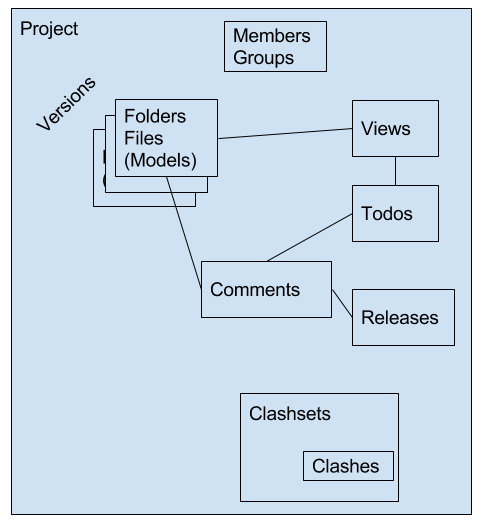
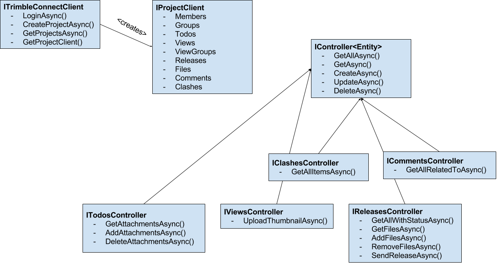

# Trimble.Connect.Client .NET SDK Developer Guide

### Content

1. [Overview](#overview)
2. [Authentication/Initialization](#authentication)
	+ [Example: Sign-in TC Platform Services](#example-sign-in)
	+ [Application tokens and CurrentUser](#app-tokens-current-user)
	+ [Regions Configuration](#regions-config)
	+ [Using the same SDK against FedRAMP](#fedramp-endpoints)
	+ [FedRAMP multipart package upload](#fedramp-multipart)
3. [TC Data Model](#data-model)
4. [Accessing TC Platform Services](#accessing-tc)
5. [Members and groups V2](#members-groups-v2)
6. [Extensibility mechanisms](#extensibility-mechanisms)
7. [Search API](#search)
8. [Code snippets](#tc_snippets)
	+  [Example: Access TC Services](#example-access-tc)
	+  [Example: How to enumerate paged results](#example-paging)
	+  [Example: Using delegating handlers to implement network activity indicator](#example-delegating-handlers)

### Acronyms

TID - Trimble Identity, identity provider

TC - Trimble Connect

## <a name="overview">Overview</a>

The Trimble.Connect.Client component represents a set of TC Platform Services REST API wrappers. All TC APIs are provided for use by connected applications as _wrappers_. Wrappers provide full create, read, update, delete (CRUD) functionality against TC entities. Wrappers work on the same abstraction level as the web API and mostly map RESTful API requests one-to-one into .NET HTTP requests.

This layer's responsibilities include:

* Consistent error handling and convenient ways to deal with varying network performance (like async mechanisms and progress reporting).
* Providing an easy to use abstraction for your targeted platforms and programming language.
* Supporting middleware message handlers
* Leveraging strongly typed entity recognition for data modeling
* Graceful error handling
* Adherence to HTTP conventions and standards

The TC REST API specification can be found here: 

* Staging: [https://app.stage.connect.trimble.com/tc/static/apidoc.html](https://app.stage.connect.trimble.com/tc/static/apidoc.html) 

* Production: [https://app.connect.trimble.com/tc/static/apidoc.html](https://app.connect.trimble.com/tc/static/apidoc.html) 

The video tutorial: [SDK Authentication using the Identity library](https://youtu.be/XaQXK4Y3TpE?t=2m20s).

## <a name="authentication">Authentication/Initialization</a>

## Obsolete Workflow
TC uses token based authentication. The token is acquired during the TID OAuth2 (OpenID Connect) authentication (see [Trimble.Identity Developer Guide](Trimble.Identity%20Developer%20Guide.md)).

It is important to understand that the ID token is generally a one use token with short life span. This means that when the token is expired and a new TID token needs to be acquired. App will have to request a new id token from TID.  This can be done by `AuthenticationContext.AcquireTokenByRefreshTokenAsync` or by using `RefreshOptions.IdToken` option in other `AuthenticationContext.AcquireTokenAsync` methods. Please refer to the [Trimble.Identity Developer Guide](Trimble.Identity%20Developer%20Guide.md).

The application should initialize the Trimble connect user with the acquired access token from TID.

## Updated workflow

The clients can use Trimble.Identity.OAuth.AuthCode for interactive workflow authentication. `Trimble.Identity.OAuth.Password` is available only for test applications, not production apps. The clients can also provide any custom implementation of `ICredentialsProvider` (including `TokenCredentialsProvider`, DPoP, or FedRAMP mTLS).

### <a name="example-sign-in">Example: Authenticating with TC API </a>


     var clientCreds = new ClientCredential(ClientId, ClientKey)
            {
                RedirectUri = new Uri(RedirectUrl),
            };
    var authCtx = new AuthenticationContext(clientCreds)
            {
                AuthorityUri = new Uri(AuthorityUrl),
            };
    var provider = new AuthCodeCredentialsProvider(authCtx)
            {
                AuthenticationRequest = new InteractiveAuthenticationRequest();
            };
			
    var config = new TrimbleConnectClientConfig { ServiceURI = TCServiceUri};
    config.RetryConfig = new RetryConfig { MaxErrorRetry = 1 };
	
    var client = new TrimbleConnectClient(config, provider);
	
	await client.InitializeTrimbleConnectUserAsync();

### <a name="app-tokens-current-user">Application tokens and CurrentUser</a>

Project wrappers such as `FilesController.GetFolderItemsAsync` require `CurrentUser` to be set. Paged results construct `QueryResult` with that user; if it is null the call fails in the client **before** any HTTP request:

```
System.ArgumentNullException: Value cannot be null.
Parameter name: user
```

`GetProjectClientAsync` copies `CurrentUser` onto the project client. If `CurrentUser` is still null and a credentials provider is set, it also calls `InitializeTrimbleConnectUserAsync()`, which loads `GET users/me`.

**Interactive user tokens.** Call `InitializeTrimbleConnectUserAsync()`. That sets `CurrentUser` using the SDK alias `"me"` and fills in the Trimble Connect profile.

**Application tokens** (client credentials, mTLS / FedRAMP, or any token that is not a Trimble Connect user). `InitializeTrimbleConnectUserAsync()` usually fails because there is no user profile. Stub `CurrentUser` **before** `GetProjectClientAsync` or file calls. Use `"me"` (the same value the SDK uses internally):

```csharp
var client = new TrimbleConnectClient(config, tokenProvider)
{
    CurrentUser = new TrimbleConnectUser("me"),
};

await client.ReadConfigurationAsync();
var projects = await client.GetProjectsAsync();
var project = projects.First();
var projectClient = await client.GetProjectClientAsync(project);
var files = await projectClient.Files.GetFolderItemsAsync(project.RootFolderIdentifier);
```

`"Unknown"` also satisfies the client null check (`new TrimbleConnectUser("Unknown")`). Prefer `"me"`. Set `CurrentUser` on the `TrimbleConnectClient` **before** `GetProjectClient` / `GetProjectClientAsync` (that copies it onto the project client). If the project client already exists with a null user, set `projectClient.CurrentUser` as well.

This is an **SDK client-side** check (`QueryResult` refuses a null user). It is not a server 403. Auth still comes from `ICredentialsProvider`; `TrimbleConnectUser.AuthenticationToken` is obsolete and can stay null. You do not need `GET users/me` for folder listing.

The stub does not make every Connect API accept an application token. APIs that need a real user profile still require a user token. Long-term, paged APIs should not require `CurrentUser` when a credentials provider is set; this stub is a caller workaround.

### <a name="regions-config">Regions Configuration </a>

The regions endpoint is hardcoded to https://app.connect.trimble.com/tc/api/2.0/regions in the Trimble.Connect.Client.Common component.

If the Trimble.Connect.Client component is initalized with a different service URI (say to point to QA, STAGE, or FedRAMP), then it is necessary to explicitly set the Regions URI.

	RegionsConfig.RegionsUri = new Uri("https://app.stage.connect.trimble.com/tc/api/2.0/regions");	

### <a name="fedramp-endpoints">Using the same SDK against FedRAMP</a>

There is no separate FedRAMP client package. Use the same `Trimble.Connect.Client` (and the same PSet, Topic, Model, Issue, Org, ECom wrappers) and point them at the **internal FedRAMP hosts**.

Set these URIs **before** `ReadConfigurationAsync` / `GetProjectClientAsync`:

| What | Commercial (default) | FedRAMP |
|---|---|---|
| Connect API (`TrimbleConnectClientConfig.ServiceURI`) | `https://app.connect.trimble.com/tc/api/2.0/` | `{fedrampConnectHost}/tc/api/2.0/` |
| Regions (`RegionsConfig.RegionsUri`) | `https://app.connect.trimble.com/tc/api/2.0/regions` | `{fedrampConnectHost}/tc/api/2.0/regions` |
| Other service clients (`PSetClientConfig.ServiceURI`, and so on) | commercial regional APIs | the matching FedRAMP regional URI |

```csharp
RegionsConfig.RegionsUri = fedrampRegionsUri;

var config = new TrimbleConnectClientConfig
{
    ServiceURI = fedrampConnectApiUri,
};

var client = new TrimbleConnectClient(config, credentialsProvider)
{
    CurrentUser = new TrimbleConnectUser("me"),
};

await client.ReadConfigurationAsync();
var projects = await client.GetProjectsAsync();
var project = projects.First();
var projectClient = await client.GetProjectClientAsync(project);
var files = await projectClient.Files.GetFolderItemsAsync(project.RootFolderIdentifier);
```

`GetProjectClientAsync` resolves the project shard from `RegionsConfig`. If `RegionsUri` is left at the commercial default, regional clients go to commercial Connect even when `ServiceURI` is FedRAMP.

**The FedRAMP regions response lists external endpoints.** Do not derive internal FedRAMP hosts from that payload (for example `region.TcpsApi`, Model, PSet, or Topic URIs). If a service must call **internal** downstream APIs, take those URLs from the **service owner** and set `ServiceURI` (and related client configs) explicitly. Inferring internals from regions will send traffic to the external FedRAMP edge.

**Interactive user sign-in** still uses `AuthCodeCredentialsProvider`. Point `AuthenticationContext.AuthorityUri` at FedRAMP TID; do not use `identity.trimble.com`.

**Application tokens** on FedRAMP use `MtlsCredentialProvider` and the FedRAMP mutual TLS token endpoint (`GovernmentTokenEndpoint`). That path is not for commercial apps. See [Developer Guide - mTLS.md](https://github.com/trimble-oss/tc-dotnet-sdk-docs/blob/main/documentation/Developer%20Guide%20-%20mTLS.md) and [Application tokens and CurrentUser](#app-tokens-current-user).

### <a name="fedramp-multipart">FedRAMP multipart package upload</a>

FedRAMP multipart uploads require a `totalParts` field in the initiate request body, which the commercial API does not accept (returns HTTP 400 if sent). To handle this automatically, add `FedRampMultipartHandler` to `TrimbleConnectClientConfig.HttpHandlers` **before** constructing the client. Commercial clients must not add this handler.

```csharp
var config = new TrimbleConnectClientConfig
{
    ServiceURI = fedrampConnectApiUri,
};
config.HttpHandlers.Add(new FedRampMultipartHandler());

var client = new TrimbleConnectClient(config, credentialsProvider)
{
    CurrentUser = new TrimbleConnectUser("me"),
};
```

The handler intercepts `POST files/fs/upload` (the initiate call), calculates `totalParts` from the declared file size, and injects it into `contents[].totalParts`. It leaves all other paths and content headers unchanged, and handles non-seekable request streams transparently.

**URL format differences.** Commercial initiate returns a `partNumber=*` template URL in `contents[].url`. FedRAMP initiate returns a `parts[]` array of pre-signed per-part URLs instead of a template. The SDK resolves the correct URL for each part automatically via `UploadUrl.GetUrlForPart()`, so the same `UploadPackageAsync` call works for both environments once the handler is in place.

**Part size rules** (same for both environments): 10 MB per part for files under 5 GB; 50 MB per part for files at or above 5 GB.

**ETag behaviour.** Server ETags returned per part are forwarded to the completion request but are not compared against local part hashes. The comparison was removed because FedRAMP S3 returns a composite ETag that does not match the local MD5.

## <a name="data-model">TC Data Model</a>



## <a name="accessing-tc">Accessing the TC API</a>

Below is a class diagram that describes the API programming models used in the SDK component to access the TC service.



## <a name="members-groups-v2">Members and groups V2</a>

Prefer **V2** for new code and for **application tokens**. V2 member IDs are CURIEs, not a bare TID UUID. Build them with `MemberIdHelper`:

* User: `users:{tidUuid}` — `MemberIdHelper.ForUser(tidUuid)`
* Application: `applications:{uuid}` — `MemberIdHelper.ForApplication(appUuid)`

Group CRUD (`Groups.CreateAsync`, `GetAllAsync`, …) stays on V1. Group **membership** has V2 methods that take `Member` (CURIE), not V1 `Person`.

### Project members — `projectClient.MembersV2`

| Method | HTTP |
|---|---|
| `ListMembersAsync` | `GET projects/{projectId}/members` |
| `InviteMemberAsync` | `POST projects/{projectId}/members` |
| `GetMemberAsync` | `GET projects/{projectId}/members/{memberId}` |
| `UpdateMemberRoleAsync` | `PATCH projects/{projectId}/members/{memberId}` |
| `RemoveMemberAsync` | `DELETE projects/{projectId}/members/{memberId}` |

`ListMembersAsync` and `GetMemberAsync` accept user or application OAuth.

For `InviteMemberAsync`, `memberId` must be a CURIE when you pass it. **`email` and `memberId` are mutually exclusive.** Passing both, or neither, throws `ArgumentException` in the SDK before the request goes out.

| Invite type | `email` | `memberId` |
|---|---|---|
| New / email invite | email address | `null` |
| Existing user by TID | `null` | `users:{tidUuid}` (`MemberIdHelper.ForUser`) |
| Application | `null` | `applications:{uuid}` (`MemberIdHelper.ForApplication`) |

Email-only invite (same as a POST that sends only `email`):

```csharp
var member = await projectClient.MembersV2.InviteMemberAsync(
    projectId,
    email,
    null,          // memberId
    Role.User,
    notify: true);
```

The returned `Member` has the id / CURIE (and usually `TidUuid`). Invite by email with `null` memberId, then build `users:{tidUuid}` from the result when you need it for get / update / remove:

```csharp
var memberCurie = MemberIdHelper.ForUser(member.TidUuid);
await projectClient.MembersV2.GetMemberAsync(projectId, memberCurie);
await projectClient.MembersV2.UpdateMemberRoleAsync(projectId, memberCurie, Role.Admin);
await projectClient.MembersV2.RemoveMemberAsync(projectId, memberCurie);
```

A bare `tidUuid` is not valid for `memberId`. Role must be `Role.User` (`"USER"`) or `Role.Admin` (`"ADMIN"`).

### Group members — `projectClient.Groups`

| Method | HTTP |
|---|---|
| `GetUsersV2Async` | `GET projects/{projectId}/groups/{groupId}/members` |
| `AddUsersV2Async` | `POST projects/{projectId}/groups/{groupId}/members` |
| `RemoveUsersV2Async` | `DELETE projects/{projectId}/groups/{groupId}/members/{memberId}` |

Pass `Member` objects whose `Identifier` is a CURIE from `MemberIdHelper`. Do not use V1 `GetUsersAsync` / `AddUsersAsync` / `RemoveUsersAsync` with an application token; those paths return **403** (`Application token not supported for this endpoint at the moment`).

## <a name="extensibility-mechanisms">Extensibility mechanisms</a>

The SDK client component is designed to be backward and forward compatible. This means that applications released with older versions of the SDK should be still functional when new TC Service APIs release. Also if by some reason app developers don't want to migrate to newer versions of the SDK but need access to new TC Service APIs this can be done as well by using extension mechanisms.

The following mechanisms are used to achieve this flexibility:

1. Each entity has a `Properties` attribute implemented as a generic dictionary. This is a collection of "unknown" or "open" properties. E.g. if a new property is added to the entity after SDK has been released app can access such property from this dictionary.
2. We prefer string literals to enums. This makes it possible to deserialize new values even if they were not known at the time of SDK compilation.
3. All updates to entities are done using PATCH requests instead of PUT.
4. There is a generic mechanism to pass additional query parameters to the `GetAllAsync` and `SearchAsync` methods
5. There is a generic mechanism to invoke any TC API method in a dynamic way: `InvokeApiAsync`.
6. Application developer can provide custom `HttpMessageHandler` and `DelegatingHandlers` when creating `TrimbleConnectClient`. This is very powerfull mechanism to implement custom processing in the http pipeline. One example can be found [below](#example-delegating-handlers).

## <a name="search">Search API</a>

The search API allows you to search for items across the projects.

    Task<IQueryResult<SearchResult>> SearchAsync(
            SearchQuery query,
            IDictionary<string, string> parameters = null,
            long? pageSize = null,
            CancellationToken cancellationToken = default(CancellationToken));

There is a convinient search query builder. 
E.g. in following example we search for ToDos created last 7 days that has a word `test` across all projects.

    var now = DateTimeOffset.UtcNow;
    var query = Search.For<Todo>("test").Between(now.AddDays(-7), now);
    await client.SearchAsync(query, 100).ReceiveAll((page) => {...});

E.g. in following example shows how to search for any entity with word `test` in specific project.

    var query = Search.For("test").In(projectIdentifier);
    await client.SearchAsync(query, 100).ReceiveAll((page) => {...});

## <a name="tc_snippets">Code Snippets</a>
Below are some examples on using the Trimble Connect Client component.
Full sample applications can be found on [github](https://github.com/Trimble-Connect/samples)

### <a name="example-access-tc">Example: Access TC API endpoints</a>

    // list all projects
    var projects = await client.GetProjectsAsync();
    var project = projects.First();
    
    // get project specific wrapper
    var projectClient = await client.GetProjectClientAsync(project);
    
    // working with todos
    var todos = await projectClient.Todos.GetAllAsync();
    
    // working with files
    var files = (await projectClient.Files.GetFolderItemsAsync(project.RootFolderIdentifier)).ToArray();

    var file = files.FirstOrDefault(f => f.Type == EntityType.File);
    var stream = await projectClient.Files.DownloadAsync(file.Identifier);
    var destPath = Path.GetTempFileName();

    using (var destination = File.Create(destPath))
    {
        await stream.CopyToAsync(destination);
    }

### <a name="example-paging">Example: How to enumerate paged results</a>

Most methods that return a list of entities (like `GetAllAsync` and `SearchAsync` methods) accept a `pageSize`  paramter and return an instance of `IQueryResult<T>`. Entities should be read from the `IQueryResult<T>` page by page. Note that `IQueryResult<T>` can be enymerated only once.

    var page = await client.SearchAsync(....);
    do
    {
		foreach(var entity in page)
		{
			// ... process each entity
		}

        if (page.HasMore)
        {
            page = await page.GetNextPageAsync(cancellationToken);
        }
        else
        {
            break;
        }
    }
	while (true);

There is a helper extension method `ReceiveAll` that encapsulates the enumeration logic for all pages and accepts a callback to be called for each page.

    await client.ClashSets.GetItemsAsync(clashset.Identifier, 100).ReceiveAll(
		(items) => { Console.WriteLine("Received {0}", items.Count()); });

### <a name="example-delegating-handlers">Example: Using delegating handlers to implement network activity indicator</a>

The code snippet below demonstrates how to use http delegating handlers to implement network activity indicator in the app.

    public class BusyHandler : DelegatingHandler
    {
        private int _callCount;
        private readonly Action<bool> _busyIndicator;
        
        public BusyHandler(Action<bool> busyIndicator)
        {
            _busyIndicator = busyIndicator;
        }
        
        protected override async Task<HttpResponseMessage> SendAsync(
          HttpRequestMessage request, CancellationToken cancellationToken)
        {
             // update the count by one in a single atomic operation. 
             // If we get a 1 back, we know we just went 'busy'
             var outgoingCount = Interlocked.Increment(ref _callCount);
             if (outgoingCount == 1)
             {
                 _busyIndicator(true);
             }
             
             var response = await base.SendAsync(request, cancellationToken);
             
             // decrement the count by one in a single atomic operation.
             // If we get a 0 back, we know we just went 'idle'
             var incomingCount = Interlocked.Decrement(ref _callCount);
             if (incomingCount == 0)
             {
                 _busyIndicator(false);
             }
             
             return response;
        }
    }

